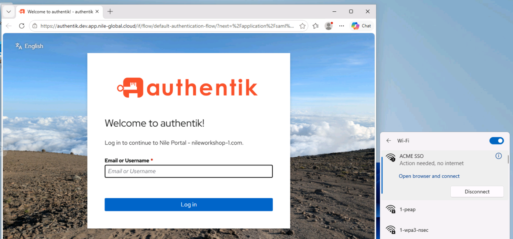

# Lab Assignment: Setup PSK SSO Wireless SSID

## 📌 Objective

Create a PSK-based SSID with SSO integration enabled, validate device connectivity, and test "Force SSO" functionality for a connected client.

## 🔧 Task Instructions

### Step 1: DHCP Setup

- Go to **Network Setup → DHCP**.
- Select `Nile DHCP` as the server type.
- Create a new DHCP scope for PSK SSO users:
  - **Pool Name** - `PSK-SSO-Scope`
  - **Network** - `192.168.12.0/24`
  - **DNS Server** - `4.2.2.1`
  - Click **Save**

### Step 2: Segments Setup

- Go to **Network Setup → Segments**.
- Create a new segment named `PSK-SSO-Segment`:
  - Select the **Service Area**.
  - Choose **HoL** and Click **OK**
  - Leave **Authentication** blank.
  - Select the **DHCP scope (Nile DHCP)** for the clients.
  - Select the **Subnet PSK-SSO-Scope** that was created in the previous step.
  - Click **Save**

### Step 3: SSID Configuration

- Navigate to **Network Setup → Wireless**.
- Click on the ➕ icon to add a new SSID.
- Configure the following:
  - **Type:** `Personal`
  - **SSID Name:** `ACME SSO`
  - **Security:** `WPA2`
  - **Pre-shared key:** `12345678`
  - **SSO:** Enable the checkbox
  - **Segment:** `PSK-SSO-Segment` (the segment created earlier).
  - Click **Save**

### Step 4: Wireless Client Onboarding

- Connect a wireless client to the new SSID.
- You should see the SSO onboarding page.
- Log in with the username and password you were given when you reserved the lab to authenticate the device.

> **⚠️ CRITICAL: READ THIS BEFORE YOU LOG IN**
>
> On Windows, after you sign in on the SSO page you will be sent **back to the same login page**. This is a known issue with the identity provider (IDP). It is **not** a Nile problem, and **your login has already worked**.
>
> - **Do NOT log in a second time.**
> - Click the **Wi-Fi icon** in the taskbar.
> - Under **ACME SSO**, click **Open browser and connect** again.
> - The device is then onboarded.
>
> 

> **ℹ️ NOTE: Your device may already be SSO authenticated**
>
> If so, you will not see the SSO login page again. In that case, force the device to authenticate again from the Nile Portal:
>
> - Navigate to **Nile Portal → Devices**.
> - Click on your device.
> - On the device details page, select **Actions → Force SSO**.

### Step 5: Force SSO (Admin View)

- In the Nile Portal, navigate to **Device Management → Devices**.
- Locate the connected client device.
- Select **Actions → Force SSO**.
- Observe the effect on the user authentication flow.

## ✅ Verification Criteria

Ensure the following conditions are met before considering the lab complete:

- SSID is visible and functional.
- User is prompted with the SSO onboarding page.
- Okta credentials authenticate the user.
- **"Force SSO"** action works from the admin side in the portal.
